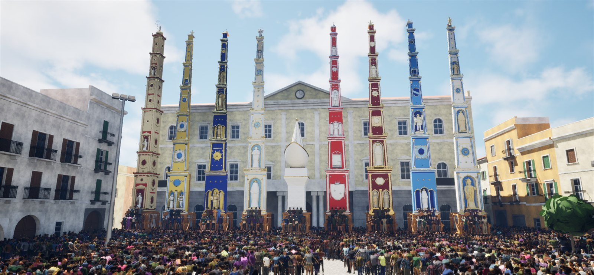
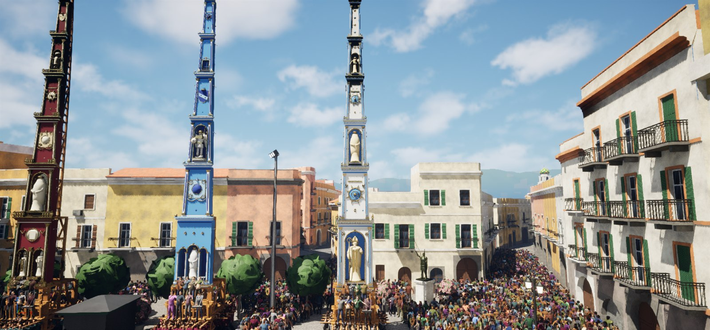

# GIGLI - La Festa dei Gigli di Nola

**GIGLI** è un gioco amatoriale per Windows sulla Festa dei Gigli di Nola: sei il *capoparanza* e porti il tuo giglio, alto circa 25 metri, a spalla per le vie vere della città, tra la folla e gli altri gigli, seguendo le regole della festa.

*Schermate dal gioco (versione in sviluppo).*

Questo repository serve **solo per scaricare il gioco**: non contiene il codice sorgente né i materiali del progetto.

---

## Come scaricarlo

1. Apri la sezione **[Releases](https://github.com/RonaldoCMS/GIGLI/releases/latest)** (a destra in questa pagina).
2. Scarica `GIGLI-0.1.0-Windows.zip` (circa 1,4 GB). Accanto c'è il file `.sha256` per controllare che il download sia integro.

**Versione attuale: 0.1.0, la prima versione giocabile.** È in sviluppo: possono esserci errori, segnalali con una Issue.

## Requisiti

Sono **stime**, non ancora verificate su molti computer diversi:

- Windows 10 o 11 a 64 bit
- scheda video con supporto a DirectX 12 e almeno 8 GB di memoria video (consigliati)
- 16 GB di RAM
- circa 10 GB di spazio libero su disco

Il gioco disegna molta folla e molti edifici insieme: con una scheda video più piccola può andare a scatti.

## Come si avvia

1. Scompatta lo zip in una cartella (non giocare direttamente dentro lo zip).
2. Esegui `GigliGame.exe`.

Al **primo avvio** il gioco prepara gli shader grafici e può essere lento a partire: è normale, aspetta qualche minuto. Dalle volte successive parte più in fretta.

## Cosa si fa nel gioco

- **Festa del pomeriggio**: il percorso intero della domenica. I gigli escono da Piazza Duomo nell'ordine ufficiale (Ortolano, Salumiere, Bettoliere, Panettiere, Barca, Beccaio, Calzolaio, Fabbro, Sarto), attraversano il Vico della Caparossa, Via San Felice, Via Cocozza, Via San Paolino e il Vico delle Carceri, fino al rientro in piazza. Tu porti uno dei nove; gli altri li guida il computer. Ci sono anche esibizioni brevi, cioè un tratto solo del percorso.
- **Festa del mattino**: i gigli arrivano in Piazza Duomo dalle loro piazze, entrano uno alla volta, si esibiscono e si posano nella loro postazione.
- **Gioco libero**: da solo in piazza, senza regole, con la folla regolabile.
- A fine partita: classifica dei nove gigli, riconoscimenti (bronzo, argento, oro) e archivio delle partite.

### Le regole in breve

Si porta il giglio come a Nola: si cammina dritti, dove guarda il giglio; per girare o aggiustarsi ci si ferma e si fa un **attento**; per posare servono due attenti e poi giù, di botto o piano. Ogni cullatore ha il suo **fiato** e si stanca: senza attenti e posate il percorso è impossibile. Le girate pulite accendono il **fuoco** della paranza, e una girata a mezzo passo seguita da un tratto avanti è la **cacciata**.

## Comandi

Nel gioco puoi tenere premuto **H** per vedere la legenda dei comandi, e nel menu c'è la schermata *Come si gioca*.

| Tasto | Cosa fa |
|---|---|
| Frecce su / giù | Avanti e indietro, con il giglio alzato |
| Frecce sinistra / destra | Di lato, solo dopo un attento |
| **X** (tenuto) | Alzata: dopo un secondo si apre la barra con la lancetta; lascia X sul verde per alzare di botto e dritto |
| **C** | Attento: un colpo di spalla, da fermi |
| **V** | Doppio attento (vale due attenti) |
| **B** / **Z** | Posa di botto / abbassa piano (dopo due attenti) |
| **Q** / **E** | Girata da fermi, a sinistra o a destra |
| **Maiusc + Q / E** | Girata con un capo solo: si muovono i cullatori davanti, quelli dietro fanno da perno |
| **Alt + Q / E** | Girata con un capo solo: si muovono i cullatori dietro, quelli davanti fanno da perno |
| **M** | Mezzo passo |
| **F** | Frusta (colpi di spalla da fermi) |
| **R** | Altezza dell'oscillazione |
| **T** | Monta o toglie i varrettieli, solo a giglio posato |
| **PagSu / PagGiù** (o rotella) | Potenza della paranza |
| **F12** | Telecamera libera (di nuovo F12 per bloccarla sul giglio): W A S D per muoversi, Spazio sale, Ctrl scende, Maiusc più veloce, mouse per guardare |
| **1 - 7** | Viste del giglio (dietro, davanti, destra, sinistra, dall'alto, frusta, torre) |
| **H** (tenuto) | Legenda dei comandi |
| **TAB** (tenuto) | Classifica in tempo reale |
| **U / Y / O** | GigliTV: diretta degli altri gigli, cambia giglio, schermo intero |
| **P** | Velocità del gioco (da x2 a x32); Maiusc + P torna normale |
| **ESC** / **Backspace** | Menu: pausa, mappa di Nola, giornata, comandi, impostazioni, ricomincia, menu principale |

## Crediti e licenze

**La festa e il percorso.** Le informazioni sulla festa vengono da: Fondazione Festa dei Gigli (percorso del pomeriggio, girate, ordine di sfilata), Comune di Nola (scheda sulla festa, stradario, pianta delle postazioni), Wikipedia, GiugnoNolano, ilturista.info, FAI (Fondo per l'Ambiente Italiano), A. Plater-Zyberk ("Festa eterna") e altre fonti elencate nei Crediti del gioco. Alcune foto di Wikimedia Commons (Giuseppe Guida, FilippoTufano, Michael LoCascio, Lucasal84, licenza CC BY-SA) sono state usate solo come riferimento e non sono incluse nel gioco.

**Mappa e dati.**
- Strade ed edifici di Nola: dati cartografici © contributori di OpenStreetMap (© OpenStreetMap contributors), licenza ODbL 1.0 - [openstreetmap.org/copyright](https://www.openstreetmap.org/copyright).
- Quote del terreno: TINITALY 1.1, INGV (Tarquini S., Isola I., Favalli M., Battistini A., Dotta G., 2023), licenza CC BY 4.0 - [doi.org/10.13127/tinitaly/1.1](https://doi.org/10.13127/tinitaly/1.1).
- Edifici storici: Catalogo generale dei Beni Culturali (ICCD), dati aperti ArCo del Ministero della Cultura.

**Musica.** I nove brani delle bande sono **originali**, composti per questo gioco (nessuna canzone esistente è citata). Sono suonati con FluidSynth (LGPL-2.1) e con il soundfont GeneralUser GS di S. Christian Collins.

**Rumori.** Folla, legno, colpi di spalla, passi e suoni dei menu vengono da librerie con licenza libera, tutte CC0 o pubblico dominio, rielaborate per il gioco:
- BigSoundBank (CC0): charlesdu76, DenisChardonnet, Joseph SARDIN, Joseph SARDIN & Axeline T., Pierre SIBANARCO, Vitoria M.
- OpenGameArt (CC0): AntumDeluge, GboxMikeFozzy, Kenney, Nocturnal_Vanguard, Ogrebane, rubberduck, StarNinjas.
- Wikimedia Commons (CC0 e pubblico dominio, anche da pdsounds.org e Freesound): eguobyte, Pierre Marshall, starlite, thore.

**Persone.** I corpi delle persone derivano da dati di MakeHuman / MPFB 2 (mesh base, forme e rig CC0, asset di sistema CC0); vestiti, capelli e colori sono fatti a mano. Lo scheletro e la posa di riferimento sono del manichino "Manny" di Unreal Engine (Epic Games). Modelli e animazioni sono stati preparati con Blender.

**Motore.** GIGLI uses the Unreal® Engine. Unreal® is a trademark or registered trademark of Epic Games, Inc. in the United States of America and elsewhere. Unreal® Engine, Copyright 1998 - 2026, Epic Games, Inc. All rights reserved.

## Avvertenza

GIGLI è un gioco **amatoriale, fatto per passione**. **Non è un prodotto ufficiale** della Fondazione Festa dei Gigli né del Comune di Nola, e non ha alcun legame con loro. I gigli e le vie sono riprodotti per omaggio a una festa che dal 2013 è patrimonio culturale immateriale dell'UNESCO. Grazie alle paranze, ai cullatori, ai capoparanza e a tutta Nola.

## Segnalare un problema

Hai trovato un errore o il gioco non parte? Apri una **Issue** da questo repository (scheda "Issues" in alto) e racconta cosa è successo: versione del gioco, versione di Windows, scheda video e, se puoi, come riprodurre il problema. Non scrivere dati personali.

## Licenza

Il gioco è distribuito **solo per uso personale**. **Tutti i diritti sono riservati**: non è consentito rivenderlo, ridistribuirlo, modificarlo o usarlo a fini commerciali senza il permesso dell'autore. Il **codice sorgente non è pubblico**. I materiali di terze parti elencati nei crediti restano soggetti alle loro licenze.
